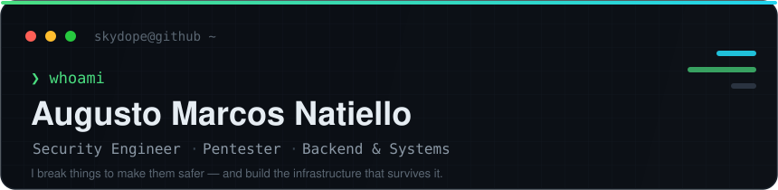

  

🇦🇷 Leer en español

 

**Ingeniero de seguridad, pentester e ingeniero de backend y sistemas.** Hago pruebas de penetración y hardening, y diseño los backends, las herramientas y la infraestructura self-hosted que tienen que aguantar esos ataques. Me muevo entre el lado ofensivo y el de construcción: entender cómo se rompe un sistema me ayuda a construirlo mejor.

---

### 🛡️ What I do

| | |
|---|---|
| **Offensive security** | Web and network pentesting, attack surface review, hardening of Linux and Windows hosts, secure-by-default tooling. |
| **Backend engineering** | APIs and services in Node.js / TypeScript and Python, relational and document databases, auth and data integrity. |
| **Systems & infrastructure** | Linux (Arch, Kali), Windows / PowerShell automation, Docker, self-hosted PaaS, VPS deployments behind reverse proxies. |
| **Product delivery** | End-to-end apps when needed: web (React, Astro, Next.js) and mobile (Flutter). |

### 🔧 Featured projects

| Project | What it is | Stack |
|---|---|---|
| [**zeus**](https://github.com/Skydope/zeus) | Windows security utilities: AES-256 authenticated file encryption, folder protection, forensic audit log with hash-chain integrity, PBKDF2 auth with progressive lockout. Ships via Scoop. | PowerShell |
| [**AIF**](https://github.com/Skydope/AIF) | Agent Instruction Format: a plain-text spec for instructing AI agents and pipelines, with typed fields and deterministic parsing. Reference parsers on npm and PyPI, plus a live playground. | TypeScript · Python |
| [**OpenGrab**](https://github.com/Skydope/OpenGrab) | Self-hosted universal video/audio downloader with a web UI and Windows desktop app. Built for homelabs. | Python |
| [**omarchy-kali-vm**](https://github.com/Skydope/omarchy-kali-vm) | Security-hardened fork of a one-click Kali VM: no privileged container, GPG signature allowlist, pinned image digests. | Shell · Docker · QEMU |
| [**loki**](https://github.com/Skydope/loki) | Privacy tool that rotates IP (via Tor), MAC address and User-Agent on a schedule. | Python |
| [**HackingResources**](https://github.com/Skydope/HackingResources) | Curated guide to get started in ethical hacking and pentesting (ES). | — |

> Also around: [**cors-proxy**](https://github.com/Skydope/cors-proxy) (lightweight CORS proxy) and [**CardShell**](https://github.com/Skydope/CardShell) (BadUSB research firmware for the M5Cardputer, for authorized labs).

### 🧰 Toolbox

**Security** &nbsp;

**Languages** &nbsp;

**Backend & data** &nbsp;

**Infra** &nbsp;

**Frontend & mobile** &nbsp;

### 📊 GitHub

---

**Open to pentesting engagements, security reviews and backend / systems work.**
Reach me through [skydope.info](https://skydope.info/).

